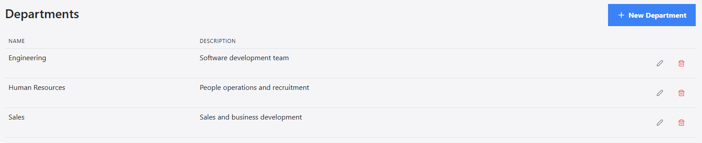
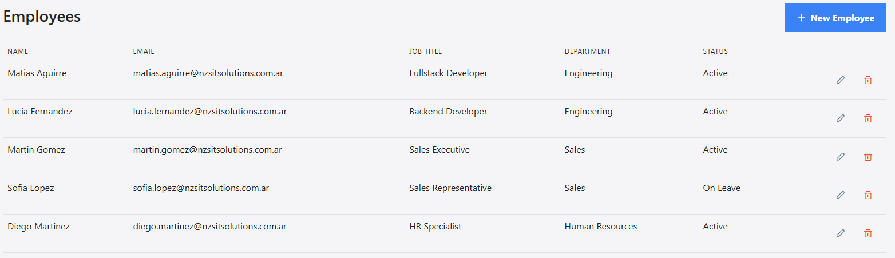
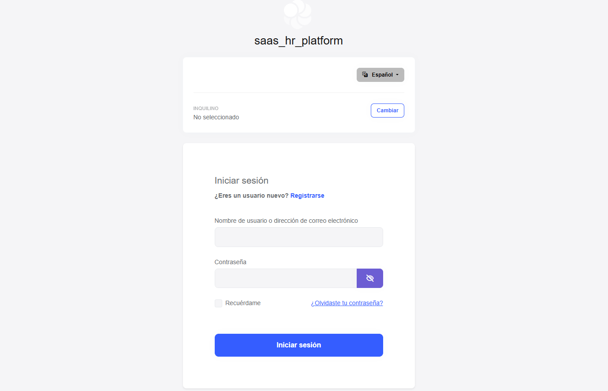

# SaaS HR Platform

Multi-tenant HR management platform built with **ABP Framework** (.NET) and **Angular**. Portfolio project — manages departments and employees within a B2B SaaS architecture, with real OAuth authentication, domain events, and a scheduled worker.

## Stack

**Backend**
- .NET 10 / ABP Framework 10.6
- PostgreSQL 16 (Entity Framework Core)
- OpenIddict (OAuth 2.0 Authorization Code + PKCE)
- Mapperly (compile-time object mapping)
- Domain-Driven Design: Aggregate Roots, Domain Services, Repositories, domain events (Event Bus), Background Workers

**Frontend**
- Angular 22 (standalone components, lazy loading)
- PrimeNG 17 + Bootstrap 5
- ABP Angular SDK (auto-generated proxies from the backend)

**Infrastructure**
- Docker + Docker Compose (multi-stage builds)
- Nginx (static server for Angular)

## Features

- Full CRUD for **Departments** and **Employees**, with business validations (unique name/email, hire date, etc.)
- Domain-level multi-tenancy
- OAuth 2.0 authentication with Authorization Code Flow + PKCE (no `client_secret` on the frontend, as it should be for a SPA)
- Domain event (`EmployeeCreatedEto`) published on employee creation, consumed by a decoupled handler
- Background Worker generating a periodic summary of active employees per department
- Localization (English / Spanish)
- Automatic seed data on startup

## Screenshots





## Getting Started

### Option 1: Docker (recommended)

Requirements: Docker and Docker Compose.

```bash
docker compose up -d --build
```

This spins up 4 containers:

| Service | Description | Port |
|---|---|---|
| `db` | PostgreSQL 16 | 5432 |
| `migrator` | Applies migrations and seeds sample data (runs once and exits) | — |
| `backend` | API (ABP HttpApi.Host) | 8080 |
| `frontend` | Angular served by Nginx | 4200 |

Once it's up:
- App: [http://localhost:4200](http://localhost:4200)
- API / Swagger: [http://localhost:8080/swagger](http://localhost:8080/swagger)

The seed automatically loads 3 departments and 5 sample employees — no manual data entry needed to see the project working.

To restart only the frontend after a change (without losing database data):
```bash
docker compose up -d --build frontend
```

To start completely from scratch (also wipes Postgres data):
```bash
docker compose down -v
docker compose up -d --build
```

### Option 2: Local development (without Docker)

Requirements: .NET 10 SDK, Node 22+, Yarn, PostgreSQL running locally.

**Backend:**
```bash
cd aspnet-core
dotnet run --project src/saas_hr_platform.DbMigrator   # applies migrations and seeds data
dotnet run --project src/saas_hr_platform.HttpApi.Host
```

**Frontend:**
```bash
cd angular
yarn install
yarn start
```

## Backend Architecture

Organized in layers following DDD (Domain-Driven Design):

```
aspnet-core/
├── src/
│   ├── saas_hr_platform.Domain.Shared/     # Constants, enums, error codes
│   ├── saas_hr_platform.Domain/            # Entities, Domain Services, events, worker
│   ├── saas_hr_platform.Application.Contracts/  # DTOs, AppService interfaces
│   ├── saas_hr_platform.Application/       # AppService implementation, mapping
│   ├── saas_hr_platform.EntityFrameworkCore/     # Persistence (EF Core, repositories)
│   ├── saas_hr_platform.HttpApi/           # Controllers
│   ├── saas_hr_platform.HttpApi.Host/      # API host / entry point
│   └── saas_hr_platform.DbMigrator/        # Migrations + data seed
```

**Notable design decisions:**
- Entities with private setters and constructor validation (Rich Domain Model) — they can never end up in an invalid state.
- Uniqueness rules (email, name) resolved in Domain Services (`DepartmentManager`, `EmployeeManager`), not in the entity or the AppService — it's the only place where querying the repository before creation actually makes sense.
- The backend runs on its own origin (not hidden behind a reverse proxy) to respect the server-rendered login flow that ABP ships with OpenIddict.

## Frontend Architecture

```
angular/src/app/
├── departments/       # List, create, edit and delete Departments
├── employees/         # List, create, edit and delete Employees
└── proxy/             # Auto-generated services and DTOs from the backend (abp generate-proxy)
```

- Standalone components, no `NgModule`.
- Lazy-loaded routes.
- A single form component reused for both create and edit (avoids duplicating the form).

## License

Portfolio project — free to use as reference.
